# Month 5 - Project 5.2 : Python Scripting : Log parser + Anomaly detection
 
**Analyst:** Jean Mik C. TINIGO
**Date:** October - November 2026
**Difficulty:** Intermediate
**Tools:** Ubuntu Desktop 24.04, Ubuntu Server 22.04, Wazuh 4.14, TheHive 5.5, Cassandra 4.1.11, Elasticsearch 7.17.29, Python3
 
---
 
## Context & Objective
 
You have Wazuh/Suricata logs running for weeks. You want to detect anomalous behavior that fixed-threshold rules don't see like an abnormally high DNS volume in a short period, a slow port scan that stays under fixed thresholds, and network activity outside business hours. You will write three progressive Python scripts.
 
---
 
## Lab Architecture
 
| Component        | Role                        | OS                      | IP             |Resources|
|------------------|-----------------------------|-------------------------|----------------|---------|
| Ubuntu Server VM | Wazuh + TheHive            | Ubuntu 22.04 Server     | 192.168.1.114  |8GB of RAM; 3 cores|
| Ubuntu Desktop VM| Wazuh agent + target        | Ubuntu 24.04 Desktop    | 192.168.1.127  |5GB of RAM; 3 cores|
| Hypervisor       | Host                        | Oracle VirtualBox 7.2.4 | -              |-|
 
---
 
## Scope and data provenance 
 
- **Data sources:** Suricata `eve.json` (alerts, flows, and DNS events) and Wazuh `alerts.json`.
- **Period covered:** `May 2026 to October 2026.`.
- **Network note:** the logs span two addressing schemes (10.209.119.x, then 192.168.1.x)
  because the lab network changed during all my lab program. IPs from both ranges can appear in
  the same results.
- **Nature of the dataset:** a lab where all activity (attacks and normal use) is generated
  by one operator, mostly in the evening. This matters for the interpretation of results
- **Reference dataset (reproducibility):** a copy of `eve.json` taken on 2026-11-20 at 07:24
  (`eve_snapshot.json`, about 1.96 GB, 219,868 flow events). Every figure of Script 2 and
  Script 3 comes from running the detector on this snapshot:
  `python3 anomaly_detector_v2.py ~/eve_snapshot.json`. The live `eve.json` keeps growing,
  so counts taken on it drift from one run to the next.
---
 
## Script 1 : Universal Wazuh/Suricata Log Parser
 
**Question answered:** what is in these logs, and what dominates them, before looking for anomalies?
 
**Input**
- `/var/ossec/logs/alerts/alerts.json` (Wazuh, one JSON object per line) on ubuntu server.
- `/var/log/suricata/eve.json`, filtered on `event_type == "alert"` on ubuntu desktop, the client.
**Method**
- Line-by-line JSON parsing; malformed lines are skipped.
- Fields kept :
    - Wazuh: timestamp, rule id, level, description, `data.src_ip`, agent name.
    - Suricata: timestamp, `src_ip`, `dest_ip`, `dest_port`, signature, severity, protocol.
- Summaries with `Counter`: top alert levels, top source IPs, top rules (Wazuh); top
  signatures and destination ports (Suricata). The ASCII bars are capped at 40 characters.
**Results (from the run)**
- Suricata: 1463 alerts. Dominant signature: `ET INFO GNU/Linux APT User-Agent` (797 hits).
  `SCAN Nmap TCP SYN packet detected`: 83 hits. Port 80: 826 alerts.
   **Screenshot - Suricata log parser :**
    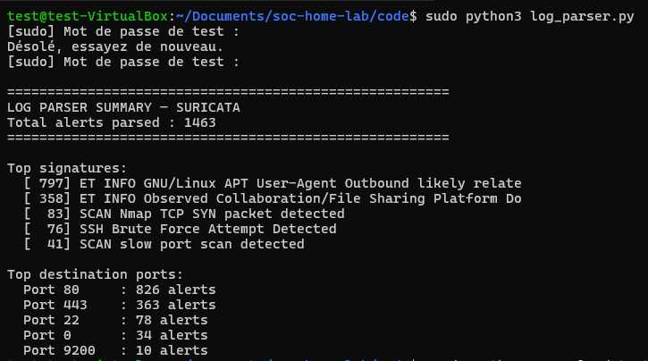
- Wazuh: 66 alerts. Level 3 dominates (59), mostly PAM events; 16 successful root `sudo`.
    **Screenshot - Wazuh log parser :**
    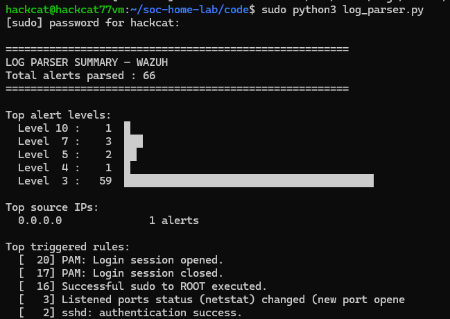
**Interpretation**
- 797 of 1463 Suricata alerts (≈ 54 %) come from a **legitimate** source (APT package
  traffic). Without a suppression/threshold, this one signature would drown any triage
  queue. In production it would be tuned or suppressed.
- The 83 Nmap alerts are the lab's own scans (known source: my own lab VM), not an external threat.
**Limitations**
 
1. **Partial Wazuh coverage:** `alerts.json` is rotated daily, so the 66 alerts are not
   the full history that the dashboard shows. Older days are archived there as .json.gz in this directory `ls /var/ossec/logs/alerts/2026/`.
2. **Field mismatch (same root cause as Project 2.3):** the parser reads `data.src_ip`
   only. Alerts decoded from sshd/PAM use `data.srcip`, so they are missing from
   "Top source IPs". Fix: `data.get("src_ip") or data.get("srcip")`.
3. Output is descriptive only: no time range filter, no export.
**Validation**
- With the log parser on Suricata we got 797 hits for this signature `ET INFO GNU/Linux APT User-Agent`. We got the same amount of hit by using this command ` sudo grep -c "ET INFO GNU/Linux APT User-Agent" /var/log/suricata/eve.json`.
**Screenshot - Validation :**
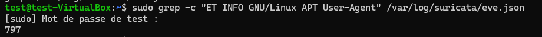
 
Find the script here : 
[Universal Log Parser](./scripts/log_parser.py)
 
---
 
## Script 2 : Behavioral Anomaly Detection
 
**Question answered:** which sources behave abnormally in ways that a fixed-threshold rule
does not express?
 
*Note: The initial version of this script (v1, kept in the /archive folder) failed to detect our custom Nmap slow scan. The script was completely rewritten (v2) to parse flow events instead of alerts, and statistical baselines were mathematically corrected.*
 
*NB: Before i run this script ,i do this to create traffic. It take approximatively 2 hours*
 
```bash
for port in $(seq 1 500); do
  nmap -p $port --open 192.168.1.127 2>/dev/null
  sleep 15
done &
```
 
### A - Slow port scan (`detect_port_scan_slow`)
 
| Item | Description |
|---|---|
| Algorithm | Group flows by (source IP, destination IP) pair and fixed 15-minute windows; count distinct destination ports; report `span_minutes` and `rate_per_min`. Detection floor: ≥ 15 ports per window (≈ 1 port/min). A slower scan is invisible to this detector. |
| Parameters | `threshold_ports = 15`, `window_minutes = 15` |
| Result | 83 findings in the reference run: 54 for `192.168.1.114` and 29 for `10.209.119.114`. Example: `192.168.1.114` -> `192.168.1.127`, window 2026-10-26 18:00, 47 distinct ports in 14.8 min. |
 
- **Assumption:** A source touching many distinct ports within 15 minutes is probing.
- **Time source:** windows are built from `flow.start` (when the connection began), not from the event `timestamp` (when Suricata wrote the record). See *Challenges and Lessons Learned*.
- **Limitations (quantified):**
  1. 20 ports in 10 minutes, split by the 20:00 boundary. Result : 0 findings. Fixed time windows miss scans that straddle the cutoff.
- **Why v2 fixed the blind spot:** In v1, we parsed Suricata `alerts`. Because our Nmap scan was sending 1 packet every 15 seconds, it never triggered Suricata's fast-scan threshold (50 SYN in 3 seconds). By switching to `flows` in v2, Python sees the raw network connections regardless of whether Suricata generated a signature alert.
- **Verdict:** true positive, expected. Both sources are the lab VM I launch my scans from: `192.168.1.114` (the Ubuntu Server VM) and, presumably, the same VM under the old addressing (`10.209.119.114`). The windows of Oct 26, 28, 29 and 30 match my own slow Nmap loop; the 3 windows of Sep 27 (1000 ports) and the May windows of `10.209.119.114` are fast scans from earlier lab phases (exact runs not recorded) 
- **Screenshot - Suricata SLOW PORT SCAN detector :**
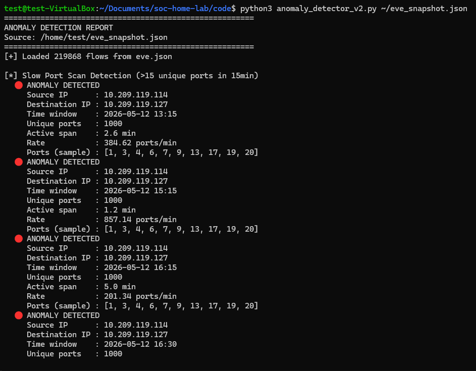
 
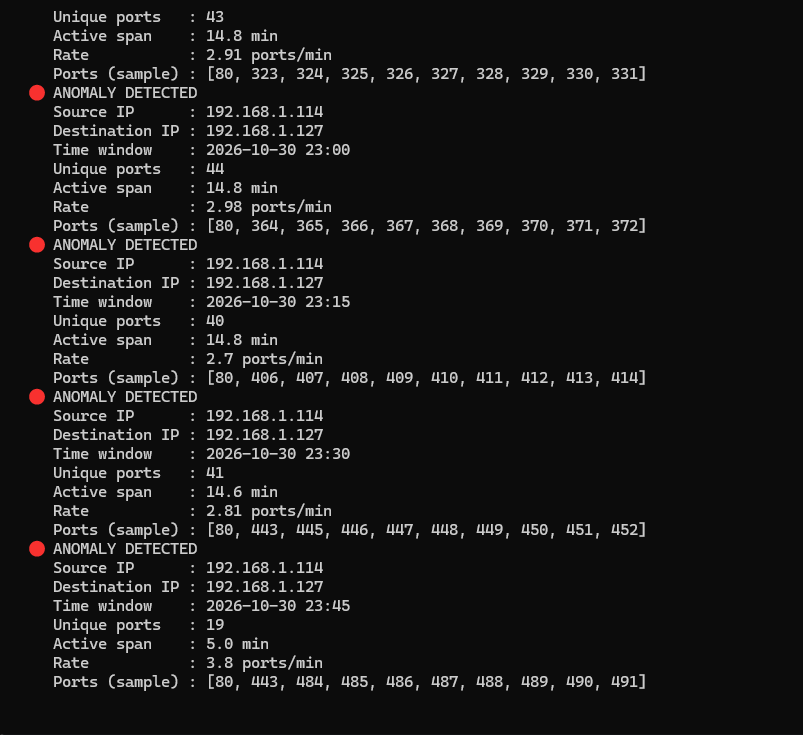
 
 
### B - DNS spike (`detect_dns_anomaly`)
 
| Item | Description |
|---|---|
| Algorithm | Count DNS events per source IP per hour. Flag an hour if `count > 3 × mean` **and** `count > mean + 2stdev`. |
| Parameters | `multiplier = 3`, `history_window = 6` (rolling baseline). |
| Why both conditions | The multiplier alone fires on tiny volumes (1 -> 4). stdev requires the hour to sit outside **this IP's own** variability. |
| Result | 14 findings in the reference run: 9 for `192.168.1.127`, 5 for the old `10.x` addresses. Example: 192.168.1.127, 256 queries at 14:00 on Oct 28 (5.4× its historical baseline). |
 
- **Assumptions:** Hourly volume is roughly stable for a given IP; the mean/stdev computed on the past 6 hours represent "normal".
- **Limitations (quantified):**
  1. One global baseline per IP ignores time of day and day of week. In production a baseline
     needs at least a full week (weekly cycle), often 2–4 weeks, compared on the same
     hour/weekday, and a rule for new IPs with no history.
  2. Eg : DNS, 6 active hours on October 1st, peak on the 20th. The "baseline from the previous 6 hours" dates back 19 days. Gaps are ignored.
- **Why v2 fixed the math:** In v1, the tested hour was part of its own baseline, inflating the mean and hiding the spike. In v2, we implemented a rolling historical baseline `(i - history_window to i)`, completely eliminating self-inclusion bias.
- **Verdict:** Benign. Cause: `connectivity-check.ubuntu.com` (241/256 queries), most likely NetworkManager connectivity checks at ~1 per 15s versus the ~300s default. Root cause not confirmed (`journalctl -u NetworkManager` for that hour). Only 1 of the 14 spikes was triaged in detail.
#### DNS Triage Validation (Post-Detection)
After the Python script flagged the DNS spikes for `192.168.1.127`, I needed to determine if this was a Command and Control (C2) beacon or benign background noise. 
 
I attempted to use `jq` and `grep` to extract the queried domains with theses commands : `grep '"src_ip":"192.168.1.127"' eve.json | grep '"event_type":"dns"' | jq -r '.dns.rrname' 2>/dev/null | sort | uniq -c | sort -nr | head`, `jq -r 'select(.event_type=="dns" and .src_ip=="192.168.1.127") | .dns.rrname' eve.json | sort | uniq -c | sort -nr | head` but ran into parsing errors due to Suricata's binary payloads and JSON formatting changes (`Invalid numeric literal` and `fichiers binaires correspondent`). To bypass this, I wrote a quick Python one-liner to parse the JSON safely and count the top queried domains at a specific datetime. I choose the one with `256 queries` in one hour `2026-10-28 14:00`.
 
`NB: Find the Python code below in Challenges section`
 
- **Screenshot - Suricata DNS SPIKE Investigation :**
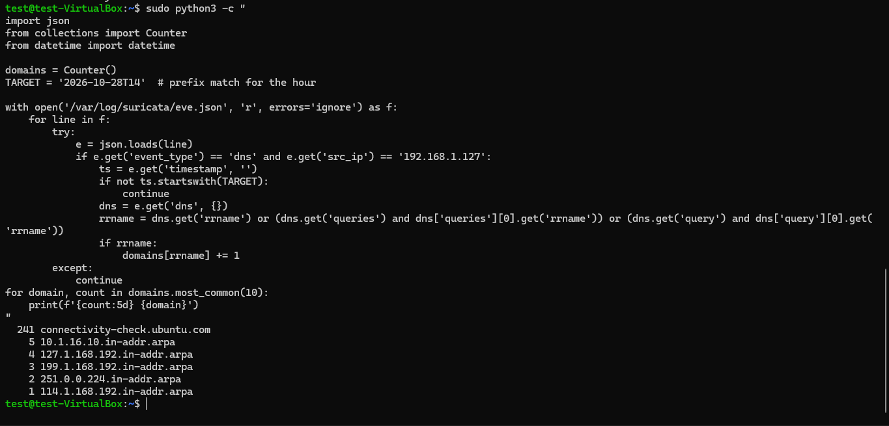
 
**Investigation Output:**
```bash
  241 connectivity-check.ubuntu.com
    5 10.1.16.10.in-addr.arpa
    4 127.1.168.192.in-addr.arpa
    3 199.1.168.192.in-addr.arpa
    2 251.0.0.224.in-addr.arpa
    1 114.1.168.192.in-addr.arpa
```
 
**Analyst Verdict:** Benign True Positive (TP).
The massive volume of DNS requests was caused by legitimate Ubuntu background services:
 
| Query | Actual IP | What it is |
|-------|-----------|------------|
| `connectivity-check.ubuntu.com` ×241 | - | Ubuntu's built-in internet connectivity probe. 241 hits in one hour is high , likely a background service (NetworkManager, `systemd-networkd`) retrying because the connection is flapping or the check is misconfigured to run very frequently. Root cause unconfirmed |
| `10.1.16.10.in-addr.arpa` ×5 | `10.16.1.10` | Reverse DNS (PTR) lookup on a host in a different subnet , probably a VM, container, or router. |
| `127.1.168.192.in-addr.arpa` ×4 | `192.168.1.127` | PTR lookup on **itself**. Normal, done by the OS or a monitoring agent. |
| `199.1.168.192.in-addr.arpa` ×3 | `192.168.1.199` | PTR lookup on a neighbor in the same /24. |
| `251.0.0.224.in-addr.arpa` ×2 | `224.0.0.251` | **mDNS multicast** address. The OS is resolving names via Multicast DNS (the Windows/Linux equivalent of "who's on this subnet?"). |
| `114.1.168.192.in-addr.arpa` ×1 | `192.168.1.114` | Another neighbor PTR lookup. |
 
The algorithm worked perfectly by identifying a massive deviation from the baseline, but manual triage confirmed it was not malicious.
 
- **Screenshot - Suricata DNS SPIKE :**
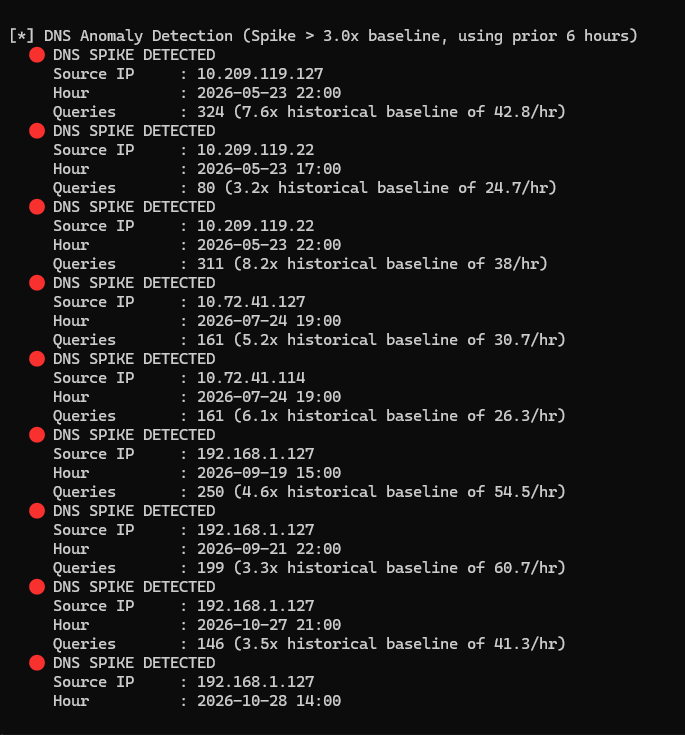
 
### C - Off-hours activity (`detect_off_hours_connections`)
 
| Item | Description |
|---|---|
| Algorithm | Count flows per source IP outside 08:00–18:00; flag if ≥ 5 events. |
| Parameters | `business_start = 8`, `business_end = 18`, minimum 5 events. |
| Result | 63 findings in the reference run (after the source-address filter fix, see *Challenges*). Example: `192.168.1.127` (Target VM): 27 to 3,083 flows per night, mostly Wazuh/OpenSearch service ports (9200, 1514, 1515 in the samples). |
 
- **What it does not analyze**: User accounts or logins. It looks at the time of network flows.
- **Why v2 fixed the noise:** In v1, this script flagged 43 different IPs, mostly due to background noise (IPv6 Link-Local fe80::, mDNS 5353, DHCP 67/68). In v2, we added NOISE_PORTS and a source-address filter (unspecified, link-local and multicast sources, based on Python's `ipaddress` module), reducing the output to the traffic of real, routable hosts. A first, string-based version of that filter silently failed (see *Challenges*).
- **Verdict:** false positive **by construction** in this lab (all work happens in the
  evening). The detector is only meaningful with a real working-hours baseline.
- **Screenshot - Suricata Off hours activity :**
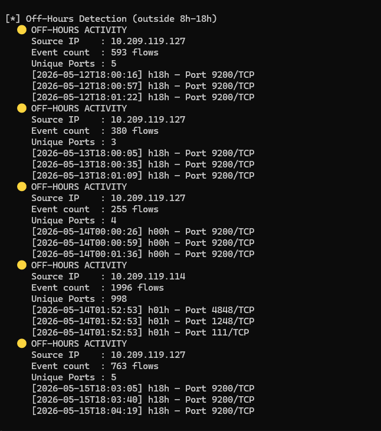
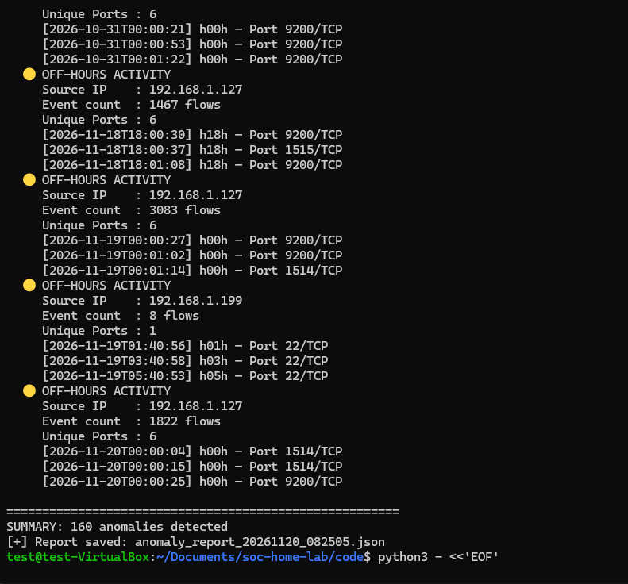
 
 
### Triage table of the anomalies detected
 
| # | Type | SourceIP | Evidence | Verdict | Reason / Analysis | Count |
|---|---|---|---|---|---|---|
| **1** | SLOW_PORT_SCAN | **192.168.1.114** | 54 windows over 5 days: 51 slow-scan windows (Oct 26, 28, 29, 30; 19 to 52 distinct ports per 15 min, median 43) + 3 fast-scan windows (Sep 27, 1000 ports). | **TP (Attack)** | **This is our targeted test.** The v2 flow-based logic detected the slow Nmap loop that Suricata missed. The Sep 27 windows are an earlier fast scan from the same VM (exact run not recorded). | `54` |
| **2** | SLOW_PORT_SCAN | **10.209.119.114** | 29 windows over 7 days (May 12 - May 24), 1000 unique ports per window. | **TP (Historical)** | Old fast-scan attacks from previous lab phases (previous addressing scheme). | `29` |
| **3** | DNS_SPIKE | **192.168.1.127** | 9 spikes (Sep 19 - Nov 20), 146 to 638 queries/hr (3.1x to 5.4x baseline). | **Benign TP** (1 triaged) / **Not triaged** (8) | Oct 28 14:00 triaged: connectivity checks (see above). The 8 other spikes were not investigated individually. | `9` |
| **4** | DNS_SPIKE | **10.209.119.x** - **10.72.41.x** | 5 spikes (May 23 - Jul 24), 80 to 324 queries/hr (3.2x to 8.2x baseline). | **Not triaged** | Logs from earlier lab phases; not investigated, so no cause is claimed. | `5` |
| **5** | OFF_HOURS_ACTIVITY | **192.168.1.114** - **192.168.1.127** | `.114`: 8 findings, 16 to 5,994 flows/night, up to 998 distinct ports. `.127`: 20 findings, 27 to 3,083 flows/night, at most 9 ports (9200, 1514, 1515 in the samples). | **FP by construction** | The lab is used at night. `.127` is Wazuh/OpenSearch service traffic; `.114` is likely the same Nmap traffic as row 1. | `28` |
| **6** | OFF_HOURS_ACTIVITY | **192.168.1.195 / .197 / .198 / .199** | 11 findings, 6 to 18 flows each, at most 3 distinct ports (22/TCP for `.197` and `.199`). | **Undetermined** | Probably my host machine (SSH client). Host IP not static, no capture available; `.195` and `.198` not checked individually. | `11` |
| **7** | OFF_HOURS_ACTIVITY | **10.209.119.114 / .127 / .183** - **10.72.41.127** | 23 findings, 8 to 4,010 flows/night (previous addressing schemes). | **FP by construction** | Same pattern as row 5 on earlier lab phases; not triaged one by one. | `23` |
| **8** | OFF_HOURS_ACTIVITY | **2c0f:53c0:xxxx:xxxx:xxxx:xxxx:xxxx:xxxx** (masked) | 1 finding, 6 flows, 1 port. | **Not triaged** | The only IPv6 source kept by the filter (a global address, not link-local). Masked here because it is a public address. | `1` |
 
**Total: 160 findings** (54 + 29 + 9 + 5 + 28 + 11 + 23 + 1) = `anomalies_found` of the reference report: 83 scan + 14 DNS + 63 off-hours.
 
> **Note on noise filtering:** v2 filters background noise (mDNS `5353`, DHCP `67/68`, and IPv6 link-local / unspecified / multicast sources). These noise sources accounted for 37 initial false positives in v1. A first, string-based version of the IPv6 filter did not work on Suricata's expanded IPv6 format (`fe80:0000:...`): the first reference run still contained 116 such findings (276 in total) until it was replaced by an `ipaddress`-based check (160 findings). See *Challenges and Lessons Learned*.
 
Find the script here : 
[Anomaly Detector](./scripts/anomaly_detector_v2.py)
 
---
 
## Script 3 - `anomaly_to_thehive_v2.py` (from finding to work item)
 
**Question answered:** how do findings become trackable, triageable items for an analyst?
 
**Input:** `anomaly_report_20261120_082505.json` produced by Script 2. (`findings` list, one dict per anomaly).
 
**Method**
 
- One `POST /api/v1/alert` per finding on TheHive 5 with a Bearer API key.
- Field mapping:
| Alert field | Value | Rationale |
|---|---|---|
| `type` / `source` | `anomaly` / `Python Anomaly Detector` | Separates automated findings from Wazuh alerts |
| `severity` | scan 2 (Medium), DNS 2 (Medium), off-hours 1 (Low) | Recon is a precursor; off-hours is noisy here |
| `tlp` | 2 (AMBER) | Same classification as the case created in Project 3.2 |
| `tags` | automated, python, anomaly, `<type>` | Filtering and metrics |
| `sourceRef` | `anomaly-<type>-<src_ip>-<time_context>` | Crucial for uniqueness. |
| `observables` | `[{"dataType": "ip", "data": "<src_ip>"}]` | Attaches the IOC as a clickable Observable. |
 
 
- Success check: HTTP 201; failures are printed, not retried.
**Result:** 160 findings (reference run) → one TheHive alert per finding. Correctly typed, tagged, severity-ranked, and with Observables attached.
 
**Limitations and design notes**
1. Plain HTTP and `verify=False`: acceptable in an isolated lab, not in production.
**Validation**
- TheHive's alert counter is cumulative (earlier runs are still there), so "findings = alerts" is not a valid check. Idempotence test instead: push the same report twice and count HTTP codes.
  - 1st push: `68` alerts created (HTTP 201) + `92` rejected with HTTP 400 (already created by earlier runs); `68` + `92` = 160.

**Screenshot - Anomaly to TheHive script first push result:**

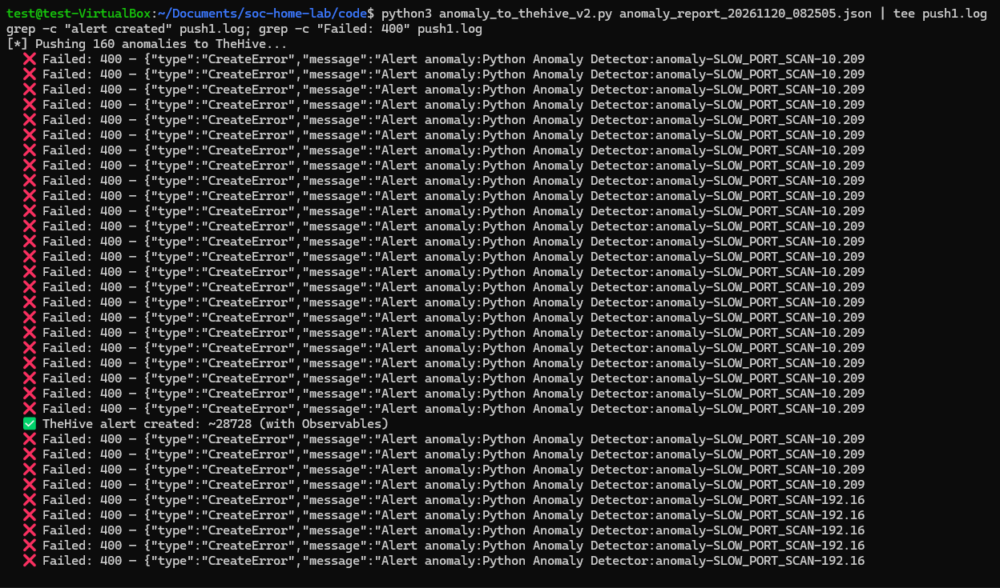
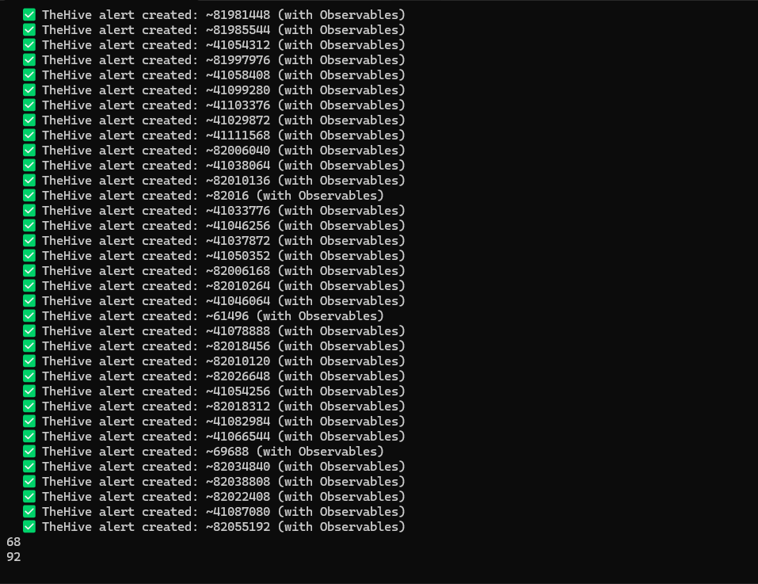
 
  - 2nd push: 0 created, 160 x HTTP 400 -> the same finding never creates a second alert. 

**Screenshot - Anomaly to TheHive script second push result:**

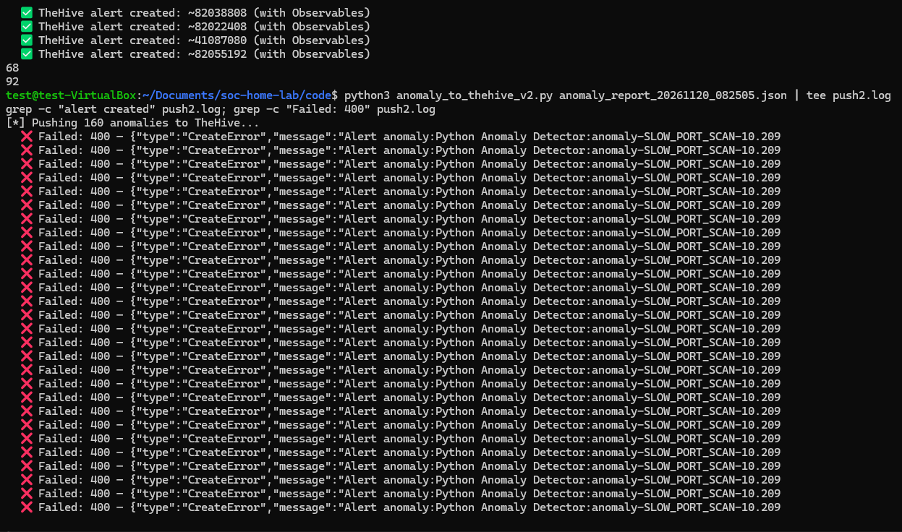
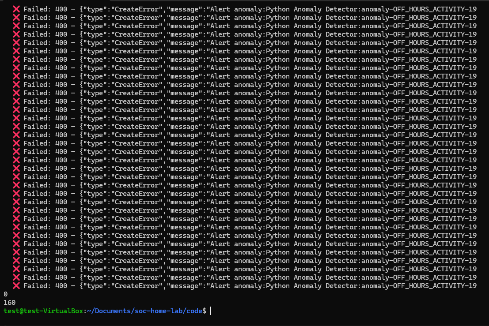

**NB: This script required several attempts before it worked as intended, and I re-ran the Nmap loop and the scripts each time. The TheHive screenshots therefore show more than 200 alerts, accumulated over several runs. The reference run for the figures in this report is `anomaly_report_20261120_082505.json` (160 findings, generated from `eve_snapshot.json`).**
 
### How to run this script 
 
```bash
# 1. Set the environment variable (do this once per terminal session)
export THEHIVE_API_KEY="your_actual_api_key_here"
 
# 2. Run the script
python3 anomaly_to_thehive_v2.py anomaly_report_<timestamp>.json
 
```
`Note : No sudo needed: the script only reads JSON and calls an API; the exported variable is inherited.`
 
**Interpretation**
 
- The failed `Failed - 400` ones is not really a failure. It's for alert that already exists on TheHive. Read the `Challenges and Lesson Learned` section to understand more.
- **Screenshot - TheHive Suricata Off hours activity alert:**
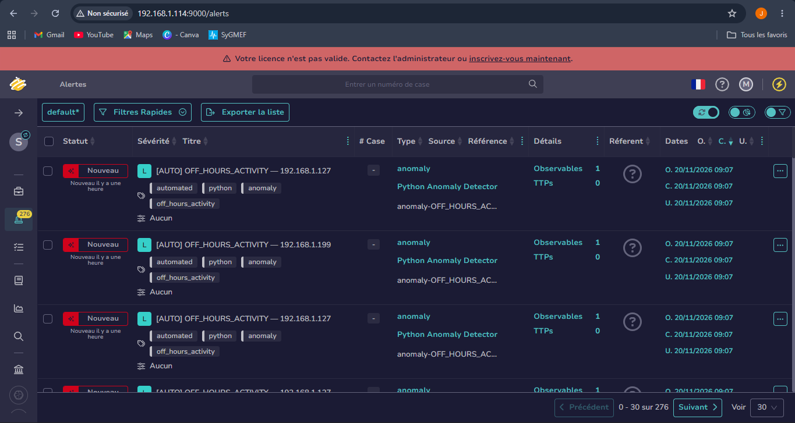
 
- **Screenshot - TheHive Suricata DNS Spike and SLOW_PORT_SCAN alerts:**
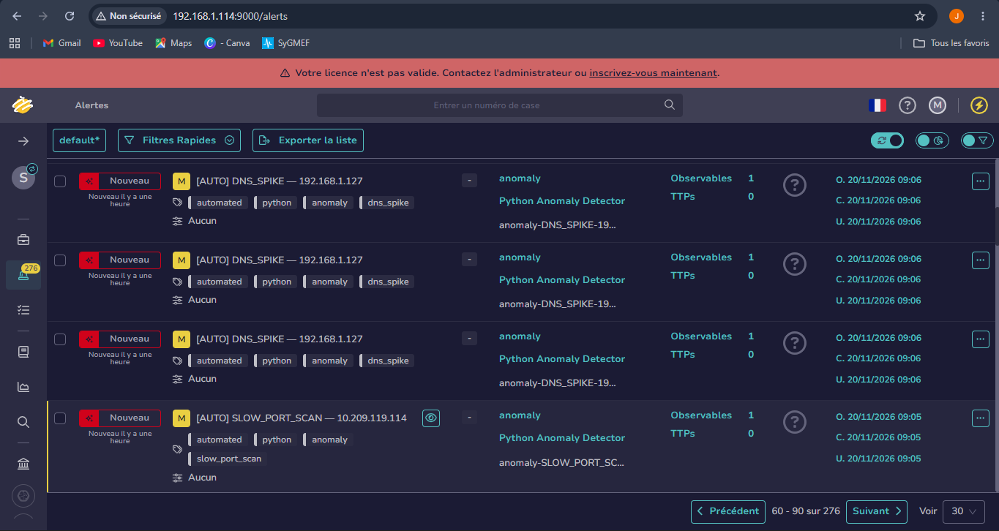
 
- **Screenshot - TheHive Suricata DNS SPIKE observable insight:**
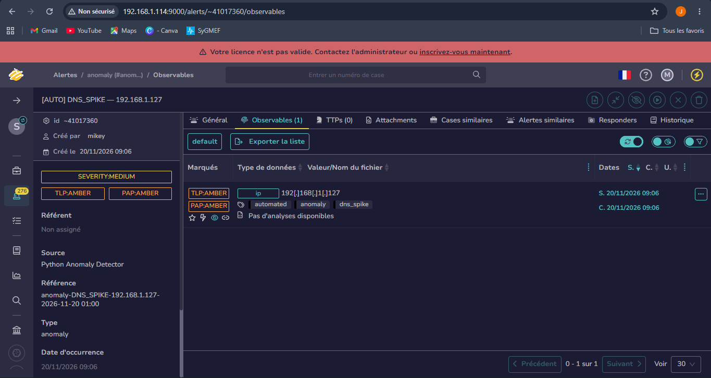
 
 
Find the script here : 
[Anomaly to TheHive version 2](./scripts/anomaly_to_thehive_v2.py)
 
---
 
## Difference between fixed-threshold detection (Wazuh) and statistical detection (Python)
 
| Criteria | Fixed-Threshold (Wazuh/Suricata) | Statistical (Python Script) |
|---|---|---|
| Logic | Triggers if `X > Threshold` (e.g., 50 SYN/sec). | Triggers if `X > 3 × mean` **and** `X > mean + 2stdev`. |
| Advantage | Very fast, easy to write, low false positive rate for loud threats. | Adapts to normal behavior (baseline). Detects "slow" or stealthy threats (Low & Slow). |
| Disadvantage | Easy to bypass (attacker scans 1 port every 5 minutes).High false positives if the threshold is too low. | Requires a learning period (baseline). More compute-intensive (CPU/RAM). |
| Use Case | Detection of volumetric attacks (DDoS, fast scans, brute force). | Detection of slow exfiltration, C2 beaconing, or stealthy scans. |
 
---
 
## MITRE ATT&CK 
 
| Technique | Name | Status | Evidence |
|---|---|---|---|
| T1046 | Network Service Scanning | `Observed` (ground truth: my own slow Nmap loop) | 51 windows (Oct 26-30), 19 to 52 distinct ports per 15-min window (median 43), 192.168.1.114 -> 192.168.1.127 |
| T1071.004 | Application Layer Protocol: DNS | Detection coverage only | DNS-spike detector would surface DNS-based C2 or tunneling; 1 of 14 spikes triaged (benign); the others not investigated |
| T1021.004 | Remote Services: SSH | Detection coverage only | Off-hours port-22 flows from 192.168.1.197 / .199 surfaced; undetermined, probably my host machine |
 
 
---
 
## Challenges and Lessons Learned
 
This project involved heavy iteration. The first versions of the scripts (kept in the `/archive` folder) successfully pushed alerts but failed to detect the intended threats. Here is how we fixed them:
 
- **The "Invisible" Slow Port Scan (Script 2, v1 -> v2) :** 
  *During the first try:* We launched a custom Nmap loop sending 1 packet every 15 seconds. The Python script failed to detect it.
  *Root Cause:* The script was parsing Suricata alerts. Suricata's signature rule needed 50 SYN packets in 3 seconds to trigger. Since the scan was slow, Suricata stayed silent, meaning Python had no data to analyze.
  *The Fix:* We rewrote the script to parse Suricata flows instead of alerts. Flows capture all network connections regardless of signatures. We also changed the time bucket from 60 minutes to a fixed 15-minute window to catch the scan faster.
- **The DNS Self-Inclusion Bias (Script 2, v1 -> v2) :**
  *During the first try:* The DNS detector calculated the mean using the entire day, including the spike itself. This artificially inflated the baseline and hid the attack.
  *The Fix:* We implemented a Rolling Historical Baseline. The script now sorts the hours chronologically and only compares the current hour against the previous 6 hours. We also added a mean < 5 filter to prevent triggering on tiny background DNS noise.
- **Off-Hours Noise Flooding (Script 2, v1 -> v2) :**
  *During the first try:* The script flagged 43 IPs for off-hours activity, creating massive alert fatigue.
  *The Fix:* We realized the network was full of background noise (IPv6 Link-Local fe80:: addresses, mDNS port 5353, DHCP ports 67/68). We added NOISE_PORTS and a source-address filter. (The first version of that filter silently failed, see the next entry.)
- **TheHive HTTP 400 Error / Duplicate Prevention (Script 3, v1 -> v2) :**
  *During the first try:* 80% of the alerts failed with a 400 Bad Request error.
  *Root Cause:* TheHive enforces a strict sourceRef uniqueness constraint. Because the script detected 40 ports scanned in a single 15-minute window, it tried to create multiple alerts with the exact same alert identity: `type + source + sourceRef`.
  *The Fix:* We appended the window (e.g., 20:15) or hour to the sourceRef, allowing TheHive to accept unique time blocks. Note: We later discovered that running the script twice on the same JSON file will still trigger 400 errors. This is expected behavior, TheHive is acting as a database constraint preventing duplicate alerts from flooding the SOC.
- **The Missing Observables (Script 3, v1 -> v2) :**
  *During the first try:* The alerts were created, but the TheHive "Observables" tab remained at 0. The IPs were stuck inside the description text.
  *Root Cause:* TheHive 4 used the artifacts JSON key, but TheHive 5 changed the API to require observables..
  *The Fix:* We updated the JSON payload key to observables, allowing analysts to pivot directly to Threat Intel platforms via a right-click on the IP.
- **The IPv6 Filter That Did Not Filter (Script 2, v2) :**
  *The Challenge:* While comparing two runs on the same snapshot, the off-hours detector still reported hundreds of `fe80:` sources although v2 was supposed to ignore them. 117 of the 276 findings came from IPv6 sources (102 link-local, 14 unspecified, 1 global).
  *Root Cause:* Suricata writes IPv6 addresses in expanded form (`fe80:0000:0000:0000:0a00:27ff:fe42:6a97`). My tests `src.startswith("fe80::")` and `"::" in src` are string comparisons on the compressed notation, so they never matched. ICMPv6 flows also use port 0, which is not in `NOISE_PORTS`.
  *The Fix:* Parse the address with Python's `ipaddress` module and drop unspecified, link-local and multicast sources (`is_noise_source()`). The reference run went from 276 to 160 findings. *Lesson:* a filter that looks right in the code must still be checked against the real log format; the bug was visible only because the output was read line by line.
- **Which Timestamp for Flows? `flow.start` vs `timestamp` (Script 2) :**
  *The Challenge:* A Suricata flow event carries two time values. I ran the detector twice on the same snapshot (219,868 flows), changing only the line that feeds the port-scan windows. Both runs predate the IPv6 fix, so their totals include the 116 IPv6 findings.
  *Result:* Totals are nearly identical: 276 findings with `flow.start`, 277 with `timestamp` (83 vs 84 scan windows). DNS (14) and off-hours (179) findings are identical because those detectors do not use the scan time source. The difference is in the metrics: among the 82 windows common to both runs, 80 show a different span or rate. Example, window 2026-05-14 01:45: 0.1 min / 12,000 ports/min with `flow.start`, 0.2 min / 4,286 ports/min with `timestamp`. Flows close to a 15-minute boundary also move from one window to the next (1 window only with `flow.start`, 2 only with `timestamp`).
  *Decision:* `flow.start`, the moment the connection began, which is when the scanner sent the probe. The event `timestamp` is when Suricata logged the record, so it blurs the pace of a scan.
 
- **Log Parsing Limitations (`jq` vs Python):**
  *The Challenge:* When attempting to triage the DNS spikes via command line, standard tools failed. `jq` threw a `parse error: Invalid numeric literal` because Suricata logs occasionally contain binary data that breaks JSON stream parsing. `grep` also failed with `fichiers binaires correspondent` (binary file matches) because it encountered null bytes (`\0`) in the network payloads.
  *The Fix:* Instead of wrestling with bash pipes, I pivoted to Python. Using `json.loads()` with an `errors='ignore'` file reader handled the binary anomalies perfectly. I also discovered that different versions of Suricata format the DNS query field differently (`.dns.rrname` vs `.dns.queries[0].rrname`), which is why a robust fallback extraction method was required. I also narrow down the search to a specific datetime from our DNS anomaly detector output section. 
  *The python code:* 
```python
  python3 -c "
    import json
    from collections import Counter
    from datetime import datetime
 
    domains = Counter()
    TARGET = '2026-10-28T14'  # prefix match for the hour
 
    with open('/var/log/suricata/eve.json', 'r', errors='ignore') as f:
        for line in f:
            try:
                e = json.loads(line)
                if e.get('event_type') == 'dns' and e.get('src_ip') == '192.168.1.127':
                    ts = e.get('timestamp', '')
                    if not ts.startswith(TARGET):
                        continue
                    dns = e.get('dns', {})
                    rrname = dns.get('rrname') or (dns.get('queries') and dns['queries'][0].get('rrname')) or (dns.get('query') and dns['query'][0].get('rrname'))
                    if rrname:
                        domains[rrname] += 1
            except:
                continue
    for domain, count in domains.most_common(10):
        print(f'{count:5d} {domain}')
  "   
```
 
 
- **Credential Management (Securing the API Key):**
  *During the first try:* The TheHive API key was hardcoded directly into the Python script (`THEHIVE_TOKEN = "..."`). If this were pushed to a public GitHub repository, automated bots would scrape the key within minutes, compromising the SOC environment.
  *The Fix:* I refactored the script to use the `os` module to read the API key from environment variables (`export THEHIVE_API_KEY="..."`). I also added a safety check (`if not THEHIVE_TOKEN`) that gracefully exits the script with a helpful error message if the variable is missing. This aligns with SOC best practices for secrets management.
- **Known limitations (documented, not fixed):**
  *Slow port scan*
  - **Detection floor:** a source must contact at least 15 distinct ports on one destination within a fixed 15-minute window (about 1 port/min). A slower scan is invisible to this detector.
  - **Fixed windows:** a scan straddling a window boundary can fall below the threshold in both windows. Test: 20 ports in 10 minutes split by the 20:00 boundary produced 0 findings. A sliding window would fix this.
  - **Time source:** scan windows use `flow.start`; the DNS and off-hours detectors use the event `timestamp` (when the record was logged).
  - **Fast scans:** a rate such as 12,000 ports/min comes from a span of a few seconds and only means "fast".
  - **Alert identity:** the TheHive `sourceRef` contains the source IP and the window but not the destination IP, so two destinations scanned from one source in the same window would collide and the second alert would be rejected with HTTP 400 (identified by code review, not reproduced in the lab).
  *DNS spike*
  - **Gap-blind baseline:** the baseline is the previous 6 *active* hours, so hours without DNS traffic are skipped.
  - **One baseline per IP:** no hour-of-day or weekday seasonality, and IPs with 6 active hours or fewer are skipped entirely. Production baselines need at least a week (often 2-4 weeks), compared on the same hour/weekday, plus a rule for new hosts.
  - **Triage depth:** only 1 of the 14 spikes (256 queries, Oct 28 14:00) was investigated; the NetworkManager root cause is unconfirmed.
  *Off-hours activity*
  - **Fixed business hours (08:00-18:00):** in a lab where all work happens in the evening, this detector is a false positive by construction. It needs a real working-hours baseline.
  - **Per (IP, calendar day) grouping:** a night crossing midnight is split into two findings.
  - **Source filter scope:** only unspecified, link-local and multicast sources are dropped. Global IPv6 sources stay (1 finding, not triaged) and so do IPv4 ICMP flows (port 0).
  - **Triage depth:** off-hours findings were triaged by source IP and volume, not flow by flow.
  *General*
  - **Uncalibrated thresholds:** 15 ports, 3x mean, mean + 2 stdev, at least 5 events and mean of at least 5 were chosen by judgment and tested against one scenario (my own scan) on a single-operator dataset. No false-positive or false-negative rate was measured.
  - **Parser:** `log_parser.py` reads `data.src_ip` only (see Script 1 limitations).
  - **TheHive push:** plain HTTP and `verify=False` (isolated lab only), no retry, and every HTTP 400 is treated as "duplicate" although it can also be a malformed payload.
---
 
## Resources Used
 
- [MITRE ATT&CK](https://attack.mitre.org)
- [TheHive Project API Documentation](https://docs.strangebee.com/thehive/api-docs/)
- [Suricata EVE JSON Format](https://docs.suricata.io/en/latest/output/eve/eve-json-format.html)